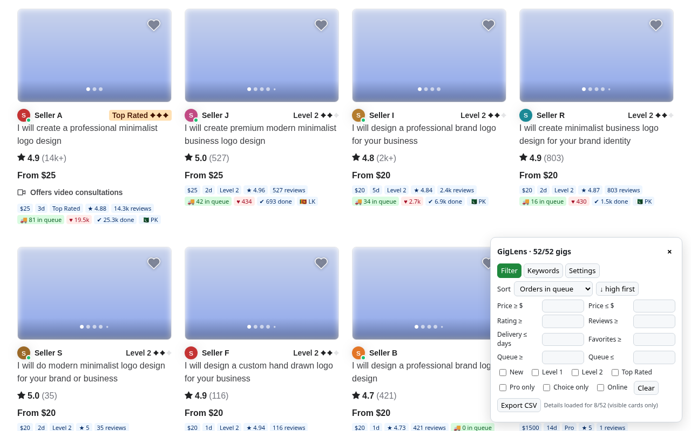
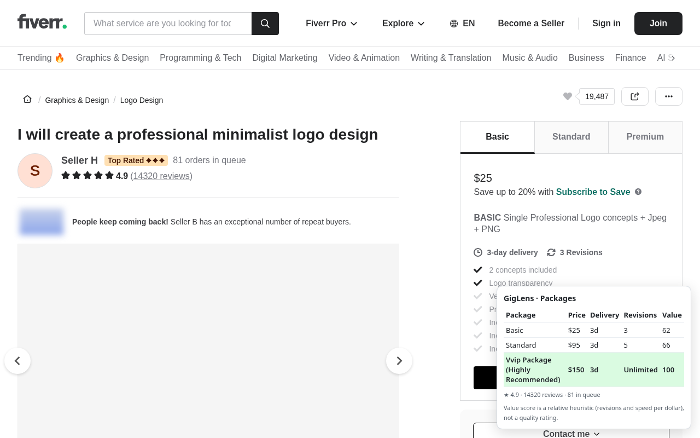
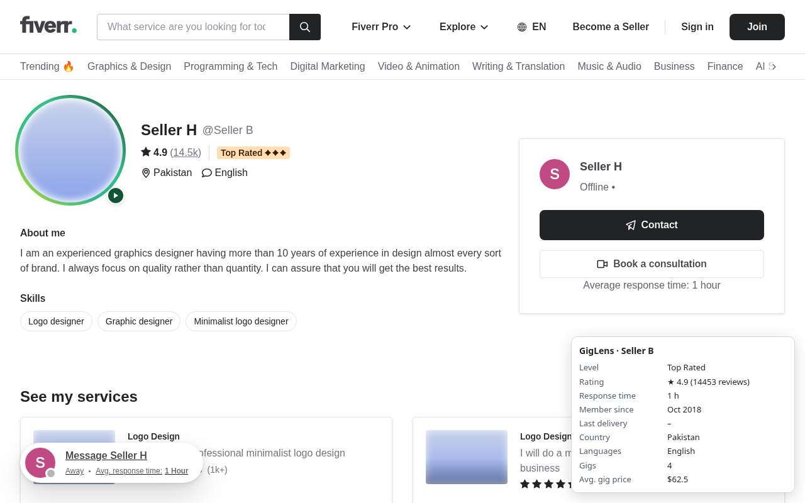

# GigLens – Marketplace Insights

A Chrome (Manifest V3) extension that shows more data on freelance gig pages on fiverr.com: search-result badges with sort/filter/CSV export, a package comparison table with a value score, and a seller stats panel.

> **Not affiliated with Fiverr.** GigLens is an independent project and is not endorsed by or connected to Fiverr International Ltd. "Fiverr" is a trademark of its owner and is used here only to describe compatibility.





_Screenshots: the built extension running on locally saved marketplace pages (no live traffic), with seller names replaced and images blurred._

## Features
| Page | What GigLens adds |
|---|---|
| Search / category | Badges: price, delivery days, level, Pro, Choice, rating, reviews, **orders in queue**, **favorites**, **seller's completed orders**, country, optional tags. Sort by any of these (both directions). Filters: price min/max, rating, reviews, delivery, queue min/max, favorites, level, Pro, Choice, online. Top keywords (tag frequency). CSV export. Cards that load while scrolling are picked up automatically. |
| Gig | Package table (price, delivery, revisions) + relative value score, orders in queue. |
| Seller profile | Level, rating, response time, member since, country, languages, gig count, avg. gig price. |

### Gig details on search pages
Orders in queue, favorites, tags, seller country and completed orders are not in search-page data; they are on each gig's own page. With **Load gig details** on (default, can be turned off in the panel's Settings tab), GigLens loads the gig page only for cards you scroll into view, **2 at a time with a 400 ms gap**, and caches results in `chrome.storage.local` for 6 hours. No other site is contacted.

## Privacy and scope
- Permissions: `storage` + host `*://*.fiverr.com/*` only.
- Reads only the page you are viewing. No background requests, crawling, server, analytics or remote code.
- See [PRIVACY.md](PRIVACY.md) / [hosted policy](https://sahinurdev.github.io/giglens/privacy.html).

## Field coverage (verified on real pages, Oct 24 2026)
| Page | Field | Source |
|---|---|---|
| Search | price, delivery, level, rating, reviews, Pro, Choice, online, country, seller reviews | search page state `listings[0].gigs[]` |
| Search | orders in queue, favorites, tags, seller completed orders, response time, price range, 5★ share | gig page state (`overview.gig.ordersInQueue`, `topNav.gigCollectedCount`, `tags.tagsGigList`, `seller.completedOrdersCount`, `sellerCard`, `reviews.breakdown`), fetched per visible card |
| Gig | package price / delivery / revisions, rating, reviews, orders in queue | `packages.packageList[]` (cents, hours, `-1` = unlimited), `overview.gig` |
| Seller | level, rating, reviews, response time, member since, country, languages, gig count, avg. gig price | `seller`, `seller.user`, `gigsData[]` |
| Seller | last delivery | not on seller pages |
| — | total sales per gig | not published anywhere on the site |

## How extraction works
Each page type has an isolated extractor in `src/extract/` that first reads embedded JSON page state (`<script id="perseus-initial-props">` / `__NEXT_DATA__`) and falls back to DOM selectors. Extractors are unit-tested against trimmed, anonymised copies of real pages in `tests/fixtures/real/` (built by `scripts/trim-fixtures.py` from raw pages in the gitignored `tests/fixtures/live/`) plus small synthetic DOM-fallback fixtures. When the marketplace changes its markup, update the relevant extractor and fixture.

**Value score**: for each package, `(min(revisions,10)+1) / sqrt(deliveryDays) / log2(price+1)`, normalised so the best package in the gig is 100. Unlimited revisions count as 10. It is a relative heuristic, not a quality rating.

## Develop
```bash
npm ci
npm test          # vitest + jsdom on fixtures
npm run build     # dist/ – load unpacked in chrome://extensions
npm run zip       # release/giglens-<version>.zip for store upload
npm run screenshots  # 1280x800 store screenshots (needs `npx playwright install chromium`)
```
Stack: TypeScript, Vite, CRXJS, Preact (UI in a shadow root).

## License
[MIT](LICENSE)
